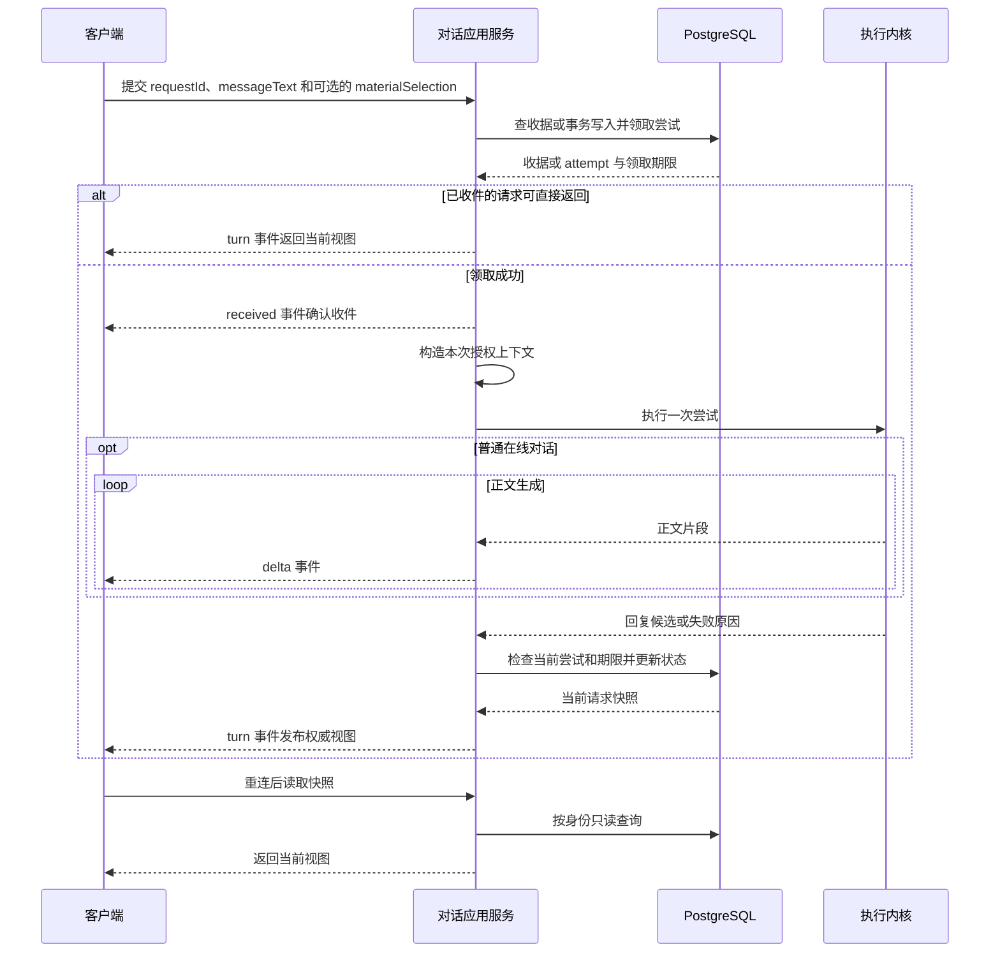

# Human Epochs 架构设计

本文定义应用服务、执行内核和学习领域的接口与数据归属。多轮对话和长材料的只读工具循环已落地，内容块和记忆系统按第 7 节的顺序推进。产品目标见[概要设计](agent-design.md)。

## 1. 设计决策

| 主题 | 设计 |
| --- | --- |
| 应用服务与执行内核 | Web 与 App 共用应用服务。应用服务负责收件和发布，执行内核只处理一次已领取的尝试。服务可跨进程重建一次执行所需的输入。 |
| 执行入口 | `runTurn` 提供统一执行入口，普通问答与材料讲解共用 `runModelLoop`。循环通过每次尝试提供的工具定义调度调用，负责配对结果、限额和退出。应用服务控制持久化状态。 |
| 工具权限 | 分开决定工具能否被模型看见、本次调用能否执行、哪些字段可以发布。先串行支持读取已选原文，再按实际参数开放独立的只读并发。 |
| 模型输入与回退 | 模型输入独立限制历史体积。同一尝试重复读取原文时仍返回配对结果，内容指向首次成功读取。模型适配器识别未完成的响应，普通问答走请求重试，材料讲解走已有的导读或摘录回退。 |
| 收件与恢复 | 在 PostgreSQL 事务中收件并保存尝试代次。按消息父链恢复材料讨论，按活动修订恢复活动状态。重连时读取快照，重试时重新构建输入并重跑整次尝试。 |
| 对话与记忆 | 原始对话记录、对话摘要和个人记忆分别管理。摘要按父链和覆盖边界读取，个人记忆按用户与用途召回。具体规则见[记忆系统设计](memory-design.md)。 |

Human Epochs 支持多设备、多用户共用服务，身份归属、请求代次和活动修订均从 PostgreSQL 读取。工具从课程和材料的具体需求开始注册，首个外部服务需要独立授权时再评审接入协议。

## 2. 分层与模块

### 2.1 分层与依赖

接入层处理交互请求，应用层协调用例。核心层包含执行内核和学习领域，分别负责当次运行以及课程与活动。

| 层 | 职责与依赖方向 |
| --- | --- |
| 接入层 | Web 和 App 通过 HTTP 使用公开契约。服务端路由校验登录态与请求，调用应用层入口并将结果映射为 HTTP 响应。 |
| 应用层 | 对话应用服务、活动协调和教学上下文负责组织用例。应用层调用执行内核与学习领域，控制收件、发布和跨模块事务。 |
| 核心层 | 执行内核依赖模型与工具接口，使用应用层传入的授权快照。学习领域通过课程接口读取题面和提示。活动模块维护活动修订、已领提示和收据，复习领域负责复习状态和排期。 |
| 基础设施层 | 模型适配器实现内核定义的模型接口。PostgreSQL 数据访问由相应数据所有者调用。`src/app/server.ts` 启动服务，`src/app/create-app.ts` 装配应用服务与 HTTP 接入，测试使用同一装配入口注入固定模型。 |

`src/contracts` 提供跨端共享的请求和响应。`activity.ts` 定义活动视图和提示领取契约，`course-content.ts` 定义课程内容结构。下图的箭头表示运行时调用。内核通过注入的 `ModelClient` 调用模型，代码依赖由模型适配器指向内核定义的接口。开始活动和领取提示通过活动协调进入领域命令。

### 2.2 模块接口与数据归属

| 层 | 模块与代码位置 | 入口与职责 | 持有的数据 |
| --- | --- | --- | --- |
| 接入 | Web 与 HTTP · `clients/web`、`src/http` | 提供对话视图、请求校验和路由映射。Cookie 和 HTTP 状态由接入层处理。 | 客户端草稿与视图。 |
| 应用 | 登录会话 · `src/app/auth.ts` | 核对凭据、创建与结束登录会话，并据此取得用户身份。 | `users` 中的账号与 `sessions.user_id` 关联的登录会话。 |
| 应用 | 运行设置 · `src/app/agent-settings.ts`、`src/http/agent-settings.ts` | 读取已保存设置，为管理员校验并提交更新。 | `agent_settings` 中的全局参数 `settings`、模型连接 `connection` 和修订号 `revision`。 |
| 应用 | 对话应用服务 · `src/app/conversation/service.ts`、`src/app/conversation/turns.ts` | `prepareTurn` 收件并领取尝试，随后运行内核、转发正文片段并发布结果。`readSnapshot` 返回一个对话的快照，`listConversations` 按最近使用列出对话。收件和回复发布规则集中在对话记录模块。 | `conversations` 中的对话标题与最近使用时间，`deleted_conversations` 中已删除的对话 ID，`conversation_command_receipts` 中重命名和删除的收据，`conversation_turns` 中所属对话、原消息、材料讨论分支与快照、回复、引文、状态、尝试序号与领取期限。 |
| 应用 | 教学上下文 · `src/app/conversation/context.ts` | `loadContext` 按身份和讨论分支读取历史及可用来源，并选择普通对话或材料讲解。 | 每次尝试读取的对话与材料快照。 |
| 应用 | 对话摘要 | 按对话范围生成可重建摘要。教学上下文按覆盖边界与来源有效性读取。 | `conversation_summaries` 中的覆盖范围、结构化摘要与来源，及后台任务收据。 |
| 应用 | 记忆提取 · `src/app/memory-extraction.ts` | 后台任务从本人开启提议后的已发布消息生成候选，逐字核对依据并按来源去重。 | `personal_memory_extractions` 中的任务领取、尝试序号和领取时的记忆修订。 |
| 应用 | 活动协调 · `src/app/activities` | 核对已完成的材料讨论并接续活动，处理活动内问答并调用活动命令。 | `discussion_activities` 关联和 `activity_conversation_turns`。 |
| 核心 | 执行内核 · `src/runtime/run-turn.ts`、`src/runtime/model-loop.ts` | `runTurn` 根据授权上下文执行一次请求尝试，`runModelLoop` 调用注入的模型、调度可用工具，并把配对后的结果交给模型。模型接口位于 `src/runtime/model.ts`。 | 本次尝试的模型消息、工具调用 ID、剩余预算和运行结果。 |
| 核心 | 模型历史 · `src/runtime/model-history.ts` | 按序列化大小保留最近的完整轮次，供普通问答与材料讲解使用。 | 本次请求发送给模型的历史消息。 |
| 核心 | 材料讲解 · `src/runtime/material-model.ts`、`src/runtime/material-discussion.ts` | 组装原文或来源目录，按需注册原文读取工具，核验回复、引文以及事件块和关系图的结构。 | 本次尝试的来源目录和引文校验范围。 |
| 核心 | 原文读取工具 · `src/runtime/tools/read-source.ts` | 声明 `read_source` 的参数结构和返回字段，从材料快照读取获准的原文并记录已返回的来源。 | 本次尝试获准读取和实际读取的原文。 |
| 核心 | 课程与材料 · `src/courses` | 提供讨论问题、导读、来源与提示。 | 课程定义与 `course_versions`。 |
| 核心 | 活动领域 · `src/activities` | 通过 `createActivity` 和 `requestHint` 受理显式命令，`getActivity` 提供当前视图。 | `activities` 中的归属、标题、课程版本、演示去重键和修订，以及已领提示和提示收据。 |
| 核心 | 复习领域 · `src/review` | 校验模型建议，维护邀请、到期时间和提醒偏好。 | 邀请、来源依赖、提醒偏好和操作收据。作答和反馈留在对话记录。 |
| 核心 | 个人记忆 · `src/app/personal-memories.ts`、`src/app/memory-candidates.ts` | `remember`、`correct`、`forget` 处理显式命令，`accept_candidate`、`reject_candidate`、`set_suggestions` 处理记忆提议，`recallPersonalMemories` 返回当前用途可读的记录。 | `personal_memories` 中的个人记录及其来源、用途授权，`personal_memory_candidates` 中待确认的提议与去重指纹，以及操作收据。 |
| 基础设施 | 模型适配器 · `src/models/chat-completions.ts` | 将内核的模型请求转换成 Chat Completions 调用，传递取消信号并校验供应商响应。 | 供应商配置和单次调用的传输数据。 |
| 基础设施 | PostgreSQL · `src/storage`、`migrations` | 提供数据库连接、通用事务入口、建表和演示初始化。 | 按各模块定义存储数据，由所有者维护写入规则。 |

内核只接收当次授权上下文、运行期限和注入的模型能力。模型适配器与时钟可替换，HTTP 和 PostgreSQL 留在执行内核之外。现有共享契约继续通过 `src/contracts` 提供给客户端。

`POST /api/login` 和 `GET /api/session` 返回 `{ user }`，Web 与服务端共用 [`User` 类型](../src/contracts/session.ts)。账号主键是 `users.id`，登录会话、对话、活动和记忆的归属字段使用 `user_id`。服务端通过登录 Cookie 确定用户身份。请求携带的 `X-User-Id` 与登录用户不一致时返回 `401`。

Web 的[页面定义](../clients/web/src/workspace-pages.tsx)集中声明路径、标题、页面组件、布局和可用条件。客户端从当前地址和登录信息解析页面，同一结果用于生成导航、页面标题与主区域。未匹配到可用页面时显示「对话」。对话页从 `#/c/<conversationId>` 读取对话；地址是 `#/` 时打开最近使用的对话，还没有对话时打开一个新对话。侧栏列出最近的对话并提供「新对话」，窄屏上随导航一起展开。服务端按登录身份独立核对接口权限。

浏览器切回前台时重新验证登录会话，并刷新对话快照。账号相同时保留页面和草稿，切换账号时按新用户重新挂载页面。前端通过[对话状态](../clients/web/src/conversation-session-state.ts)合并已发布快照、请求收件与流式进度，统一推导发送、停止、重试与恢复的界面状态。

## 3. 对话请求、执行与恢复

用户可以有多个对话，每个对话有多轮问答。客户端为新对话生成 `conversationId`，地址为 `#/c/<conversationId>`；第一条消息收件时在同一事务里创建对话，标题取这条消息的前 40 个字，之后每次收件更新最近使用时间。尚未发出消息的对话不保存。`GET /api/conversations` 按最近使用返回对话列表，`GET /api/conversations/:conversationId` 返回该对话的快照，不存在的对话返回空快照。`POST /api/conversation` 用 `conversationId` 指定对话，用 `requestId` 标识一次提交，同一请求不能在另一个对话里重放。`POST /api/conversations/:conversationId/commands` 受理重命名 `rename` 和删除 `delete`，以稳定的 `commandId` 和命令指纹记收据，重放时返回当前列表。删除在一个事务里移除对话的消息、回复、复习邀请、记忆提议、提取任务和摘要；从这个对话保存的个人记忆保留并清空来源，由讨论开始的活动保留并解除与讨论的关联。被删除的对话 ID 记入 `deleted_conversations`，之后发往它的消息、复习命令和快照读取返回 `410`，迟到的请求不会重建对话。每个对话同时最多有一条回复在生成，不同对话互不阻塞。材料追问的父消息必须属于同一对话，普通对话的模型历史和摘要也只读当前对话。用 `messageText` 传入用户原话，材料选择使用可选的 `materialSelection`。Web 的「附加原文」把粘贴的文字或在浏览器里读取的文件作为 `excerpt` 发出：.txt、.md 直接读取，PDF 由 `pdfjs-dist` 逐页提取文字并在每页开头标注「【第 N 页】」，.docx 由 `mammoth` 提取正文。两个解析库在选择这类文件时才加载，原件不上传，文件以 20 MB 为限；读不出文字的扫描件和旧版 .doc 给出原因。超出上限时，PDF 默认选择放得下的前几页并可调整页码范围，其他文字可以只保留前面部分。单份原文与整段讨论都以 `materialTextLimit`（32,000 字符）和 `materialSourceLimit`（16 份）为上限。新消息是否接着讨论由客户端从已发布轮次推出：最近一条完成的轮次是材料讨论时带上 `parentRequestId`，用户选择结束讨论时不带；待发送的原文和这一选择保存在该对话的草稿里。`kind: 'user'` 的轮次返回 `messageText`、`replyBlocks` 和适用时的材料快照 `materialContext`。`kind: 'review_question'` 的轮次返回 `questionBlocks`。失败重试通过尝试序号区分。同一次尝试可以包含多个模型和工具步骤。步骤共用当次上下文与预算，属于同一请求的执行过程，最终发布一条用户可读的回复。

- **收件。** 当前每个用户有一段普通对话，后端按 `userId` 和 `requestId` 查收据，同一时刻只有一条消息在生成。重试保留 ID 和原消息，已选材料从收件快照恢复。使用同一 ID 改写已收件内容时返回冲突。应用服务在短事务内保存输入及尝试序号，事务结束后才调用内核。
- **执行。** 内核根据授权后的上下文和领取期限运行本地引导、在线对话或材料讲解。普通对话和短材料一次模型调用即可结束。长材料路径先发送来源目录，模型请求读取原文后，内核校验范围并按调用 ID 把结果交给模型组织回复。内核验证材料引文并返回候选或失败原因，应用服务按当前领取状态发布结果。
- **限额。** 每个请求最多三次尝试，每次领取期限为 90 秒。普通对话和短材料每次尝试最多一次模型调用。长材料默认最多三次模型调用和四次工具读取，最后一次模型调用用于生成回复。每次模型调用取配置的单次超时与剩余总时长中的较小值。调用失败或预算用尽时，材料讲解使用课程导读或原文摘录回退。
- **发布。** 应用服务接收执行内核已校验的候选回复。模型生成的引文须出自本次交给模型的指定原文片段，静态导读与摘录回退使用本轮获准的来源。数据库更新同时匹配用户、请求 ID、尝试序号、运行状态和未过期的期限。若旧尝试已失去更新资格，应用服务返回数据库里现有的视图。
- **恢复。** `GET /api/conversations/:conversationId` 只读。客户端恢复时用服务端快照替换当前视图，包括空结果。进程退出后，过期的收件按剩余次数显示为可重试或失败。显式重试重新领取并递增尝试序号；首阶段从原始收件重建上下文并重跑完整尝试。新问题可以替代已经结束的可重试请求。
- **回复流。** `POST /api/conversation` 收件后以 `text/event-stream` 返回。每条连接对应一次提交。新尝试先发送 `received`，执行中可发送 `delta` 或 `progress`，最后通过 `turn` 发布数据库中的当前视图。已收件且无需执行的提交只返回当前 `turn`。收件前的校验和冲突使用 HTTP `400`、`409`。未使用记忆的普通在线对话转发模型正文，正文里的图示代码块在发布时拆成结构块，客户端在生成中把它显示为占位。材料讲解的进度使用 `reading_sources` 和 `checking_citations`，正文核验后随终态发布。连接中断时清除临时正文，通过 `GET /api/conversations/:conversationId` 恢复。服务端继续执行有效尝试，运行受领取期限和模型超时约束。
- **停止。** `POST /api/conversation/:requestId/stop` 按登录用户和请求 ID 停止仍在领取期内的尝试，并返回 `{ turn }`。数据库以 `stopped` 保存原消息和空回复，重复停止或重放原请求返回当前视图，超出归属的请求返回 `404`。由同一服务进程运行的模型调用收到中断信号，所有进程的发布写入都受数据库状态约束。停止和发布并发时，以先完成的状态写入为准。断线后的快照读取可看到已停止的状态。

### 运行设置

Web 侧栏的「运行设置」由部署名单控制。`GET /api/agent-settings` 返回当前 `revision`、运行参数 `settings`、连接 `connection` 和在线模型可用状态 `onlineModelAvailable`。连接视图包含 Base URL、模型 ID 和密钥配置状态。`PUT /api/agent-settings` 接收 `expectedRevision`、运行参数及可选的连接修改，校验后原子更新配置。修订冲突返回 `409`。首次读取使用部署默认连接。新领取的在线模型尝试从同一份快照取得运行参数、端点和凭据。

`POST /api/agent-settings/assistant` 共用管理员授权，使用当前已保存的模型生成说明和草案。助手只收到运行参数、模型 ID 和最近的设置对话。它可以建议模型 ID 和数值参数。管理员可把草案填入表单，再经同一个修订校验入口保存。设置对话在当前页面打开期间保留。

| 界面分区 | 参数 | 默认 | 可设范围 | 作用 |
| --- | --- | --- | --- | --- |
| 模型连接 | Base URL、API Key、模型 ID | 部署默认 | 公网 HTTPS 地址或部署允许的内部地址 | 决定下一次在线尝试使用的 Chat Completions 端点、凭据和模型。 |
| 模型生成 | 输出上限 | DeepSeek 393,216 Token，自定义地址默认 2,048 | 1–393,216 | 传给每次调用的 `max_tokens` 或 `max_completion_tokens`，按供应商能力调整。 |
| 上下文与材料 | 历史预算 | 32,000 字节 | 25,000–64,000 | 限制已授权的历史消息 JSON，保留当前问题和近期完整轮次。 |
| 上下文与材料 | 原文直传阈值 | 4,000 字符 | 500–8,000 | 原文总长度在阈值以内时随请求发送。超过阈值时先提供来源目录，再按需读取原文。 |
| 执行预算 | 单次模型超时 | 45 秒 | 5–60 | 与尝试剩余时间一起约束单次请求。 |
| 执行预算 | 长材料模型调用上限 | 3 次 | 2–5 | 包含最终生成回复的一次调用。 |
| 执行预算 | 长材料工具调用上限 | 4 次 | 1–8 | 同一次尝试内只读调用和重复读取共用限额。 |

服务端用 AES-256-GCM 加密 Web 提交的 API Key，将 Base URL 作为关联数据一起验证。换地址必须提交新 Key。运行时在模型适配边界解密，并通过供应商请求的 Authorization 头使用。配置接口仅返回密钥状态。公网连接的 DNS 检查发生在建立连接时，模型请求拒绝重定向。部署可明确允许完整的内部 Base URL。DeepSeek 显示 1M Token 上下文，应用的历史预算以 JSON 字节计量。

## 4. 上下文、工具与学习记录

### 上下文组装

普通对话读取当前收件之前最近的已完成普通轮次。材料讨论中的追问从父消息回溯当前分支，读取收件时的材料快照。课程导读只在其依据的原文与本轮可用原文一致时用于回复。用户粘贴的原文和历史发言都作为数据传给模型。应用服务单独提供本次任务目标与允许的能力。

活动内问答按用户和活动 ID 读取公开材料、已领提示和活动消息。学习对话使用该对话的历史、用户选择的材料和本次获准的记忆。

普通问答和材料讲解在发送前应用配置的历史消息 JSON 序列化预算。内核从当前问题向前保留能容纳的最近完整轮次。这个预算只作用于供应商输入中的历史部分，授权判断与对话记录继续使用各自的上下文。来源目录和获准原文按各自的上限处理，独立于历史预算。

### 工具契约

工具以稳定名称注册，向模型公开参数结构。模型循环按本次尝试注册的工具列表分发调用，校验调用 ID 和 JSON 格式。工具核验参数、授权范围与返回结构，只向模型提供完成当前任务所需的字段。客户端通过应用服务取得已发布视图。扩展工具时，由应用服务按身份和资源可见范围构造授权上下文，工具按本次参数落实可用条件。

已选原文总长度超过配置的直传阈值时，材料讲解用来源 ID 和名称组成来源目录，并开放 `read_source`。参数校验通过后再核对来源是否在本轮已选范围内。工具按调用 ID 串行执行并配对结果，最后一次模型调用由 `tool_choice: none` 保留给回复。首次成功读取返回原文，重复调用计入工具预算，并通过 `previousToolCallId` 指向仍在模型上下文中的首次结果。模型引文须逐字对上本次工具实际返回的原文。未知工具、无效参数和越界来源有各自的运行结果。工具参数和正文只用于本次尝试，对话记录保存最终回复及其引文。后续需要并发时，可在同一快照内并行执行相互独立的只读调用。领域写入继续走显式命令。

### 内容模型与存储

对话应用服务提供本轮允许的类型、呈现形式和资源范围。AI 决定选用哪些内容块、采用何种形式和如何排序。服务端按用户身份和资源归属校验并保存已发布的结构与来源，客户端按选择渲染组件并适配设备。内容契约、存储、呈现、发布流程和验收条件见[学习内容呈现技术设计](content-presentation.md)。

### 活动与提示

`POST /api/conversation/:requestId/activity` 为已完成且可接续的讨论创建活动，在同一事务内写入 `activities` 和 `discussion_activities`。发起或重复调用该命令都会返回本讨论对应的活动 ID。`discussionVersion` 标识材料讨论的发布版本，活动的 `courseVersion` 标识所用课程的版本，活动状态通过 `revision` 跟踪。活动标题取自课程，演示初始化按用户和活动的 `seed_key` 去重。`GET /api/activities/:activityId/conversation` 返回活动内问答及用于发起活动的材料讨论记录（如有），`POST` 在同一路径接收活动内消息。明确索取提示时以消息请求 ID 调用领域入口。

`POST /api/activities/:activityId/hints` 在活动锁内先查操作收据，再核对 `expectedRevision` 及剩余提示。领取事务一并写入 `hintText` 的收据、更新 `claimedHints` 和活动的当前 `revision`。两端重放同一操作会读到原提示和当前活动。各端通过 `GET /api/activities/:activityId` 读取活动标题、课程信息、已领提示和可用操作。活动内问答提交 `messageText` 和 `expectedRevision`，发布后返回该轮的 `replyText`。

### 主动复习

复习由对话应用服务协调，内部复习领域持有邀请、到期时间和提醒偏好。复用材料讲解的结构化模型输出、来源核验和对话收件流程。用户可以从新对话里的课程示例开始，或直接在对话中提到课程材料的标题。

1. **安排。** 在线模型可以在材料讲解或复习反馈里附上复习主题、复习题题面、参考要点、引文及建议间隔。复习题的来源限于本轮已读的原文，引文须逐字出自发起讨论那一轮保存的材料快照。课程原文还须与当前发布的课程一致，课程更新后旧邀请失效；用户附加的原文（`excerpt:` 来源）只核对快照，删除所在对话时邀请随之失效。复习建议使用 1 至 30 天的整数间隔。服务端独立校验建议，按时钟计算到期时间，并与对话回复一起提交。没有有效建议时照常发布回复。每位用户最多保留一条来源仍有效的待处理邀请。邀请随附来源名称和所在对话的标题，可以在任意对话里接受，复习题发布到接受它的对话。
2. **邀请。** 邀请属于用户。每个对话的快照都随附当前到期的 `reviewInvitation`，对话内只显示一条可略过的邀请，出现时保持当前焦点。`POST /api/conversation/review-invitations` 通过 `reviewInvitationId` 受理接受、稍后和停止提醒，先查稳定操作 ID 的收据，再核对邀请状态和来源。命令带有 `conversationId`，接受时在同一事务内把复习题发布到这个对话并保存收据，双端重复接受回到同一题。稍后将原题推迟一天，停止提醒会取消待处理的邀请并停止后续主动邀约。
3. **作答。** 用户继续发送对话消息。应用服务按题目关联读取原文和答案依据，AI 根据实际作答反馈，并判断是否需要再安排一题。换话题、跳过和未回应都不作为作答证据。答案依据在反馈阶段才公开。复习题通过独立消息类型保存，来源失效时仍保留这一类型，题面与作答入口随来源失效。记忆来源只接收用户消息。服务端拒绝使用旧来源的尝试写入。

验收用固定模型和时钟走通从材料讨论到主动邀请、作答和再次安排。检查建议异常时正常回复、到期前保持无邀请、略过后继续对话、跨端重放、停止提醒和来源失效。评价复习效果时抽样检查间隔后的换题作答。

## 5. 对话摘要与个人记忆

摘要用于接续被历史预算裁剪的前文。后台任务从已发布的有效记录生成带覆盖边界和来源的摘要。教学上下文按普通对话顺序或材料父链选择摘要，并保留当前问题和近期完整轮次。

个人记忆接入显式保存、纠正、忘记、按用途读取和需本人确认的记忆提议。`GET /api/conversations/:conversationId` 在同一快照返回用户消息和本人可管理的记忆，客户端按来源消息就地呈现。来源纠正、删除与撤权在原领域提交时更新来源状态和记忆修订，摘要与对话发布在事务中复查当前尝试和依赖。读取记忆的回复随已核验终态发布。数据模型、任务领取、召回、删除和验收见[记忆系统设计](memory-design.md)。

## 6. 可观测性与验收

| 场景 | 验收条件 |
| --- | --- |
| 常规回复与材料讲解 | 使用固定模型输出，对照原有普通问答、分支续问、引用核验和导读回退。模型输入中的消息与来源可回溯到同一用户的本轮记录。 |
| 模型输入与完成条件 | 长历史按完整轮次裁剪。同一尝试内的重复读取仍按调用 ID 配对，并引用第一次返回的原文。供应商返回截断或中断状态时，只发布经核验的回退内容，或保留请求供重试。 |
| 故障与并发 | 收件后进程退出，另一端读取状态，显式重试后旧回复迟到。两端得到同一权威回复，过期尝试无法覆盖。领取次数耗尽后状态终止。 |
| 工具配对与权限 | 用固定工具返回验证调用 ID，拒绝读取本轮所选范围以外的原文，包括其他分支或其他用户的材料。后续开放并发时，乱序完成的结果仍按调用 ID 配对。 |
| 领域行为 | 并发领取提示按活动修订协调。同一操作的跨端重放返回同一提示。 |
| 内容呈现 | 核对跨端同源、引用可核验和活动公开字段。各内容类型的通过条件见[内容呈现验收](content-presentation.md#实施顺序与验收)。 |
| 流式回复与恢复 | 普通在线对话可在模型结束前显示正文片段。中断后清除未完成的片段，重试沿用请求 ID，两端读取同一份已发布回复。空的对话快照也会替换旧视图。 |
| 显式停止 | 用另一端停止正在生成的请求，两端都能看到原消息与 `stopped` 状态，模型调用收到中断信号。检查重复停止、越权、已发布后的停止和迟到结果。 |
| 记忆有效性 | 同分支接续保留摘要边界，跨用途和跨用户读取只返回获准记录。并发纠正、删除和撤权后，旧任务与旧回复无法发布。见[记忆验收](memory-design.md#实施与验收)。 |

服务进程将结构化对话日志写到标准错误流。按 `requestId` 和 `attempt` 关联收件、模型、工具、材料回退、停止和发布事件。模型调用记录序号、耗时、完成类别及供应商返回的输入和输出 token 计数。工具记录调用 ID、耗时及参数错误、拒绝或成功。引文校验回退与发布时发现的记忆失效分别记录。应用日志只记录这些元数据，省略原文、模型回复、工具参数、完整提示词及凭据。

## 7. 实施顺序

| 顺序 | 实施内容 | 进入下一步的条件 |
| --- | --- | --- |
| 1. 提取执行入口（已落地） | HTTP 接入与对话、活动应用服务分开，请求内核承接本地引导与模型调用。复用现有 POST/GET 请求、`conversation_turns` 和活动命令。 | 对话续问、引文、提示与重试用例通过，普通问答和材料问答可注入固定模型。 |
| 2. 支持请求内多步执行（已落地） | 长材料讨论可通过只读工具按来源读取原文。调用串行执行，并受模型、工具次数和总时长约束。 | 固定模型先按来源请求原文，拿到配对结果后形成回复。两端读到同一条已发布回复，重放已完成请求直接读回原回复。越界读取、未读引文和耗尽预算由接口校验或回退处理。 |
| 3. 首批内容块（已落地） | 交付正文、摘录和段落引用，随后接入事件记录 `event_log` 和流程与关系图 `diagram`。其他类型按具体学习场景接入。 [内容呈现设计](content-presentation.md#实施顺序与验收) | 内容块通过双端回看、顺序核对和来源核验。 |
| 4. 对话摘要与个人记忆（已落地） | 先用长对话回放定位历史裁剪损失，接入可重建摘要，再实现显式个人记忆和需本人确认的记忆提取候选。后续根据试用决定是否做整理与语义检索。 | 摘要和个人记忆通过[分支、用途、并发与失效验收](memory-design.md#实施与验收)。 |
| 5. 主动复习（已落地） | 从课程材料讨论接通 AI 选题、安排时机、复习邀请和作答反馈。 | 通过[主动复习](#主动复习)的来源、重复操作、跨端接续和换题作答验收。 |
| 按实际需求扩展执行 | 多步讲解需要可见进度时扩展回复流。需要从中间步骤恢复或增加有副作用的能力时，设计工具收据和恢复事务。 | 执行扩展通过对应的中断和恢复测试。 |

开发阶段维持单一初始化迁移。新表与契约变更并入该迁移。API 开始监听和领取后台任务前核对已应用的迁移及其校验和。原生 App 可在有移动端专属交互需求时接入同一套发布视图、命令和恢复接口。运行依赖和启动方式见[技术选型](technology-choices.md)与[启动说明](../README.md)。
